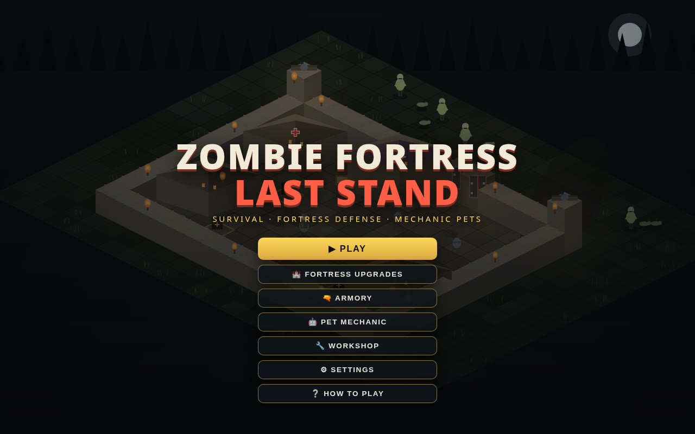
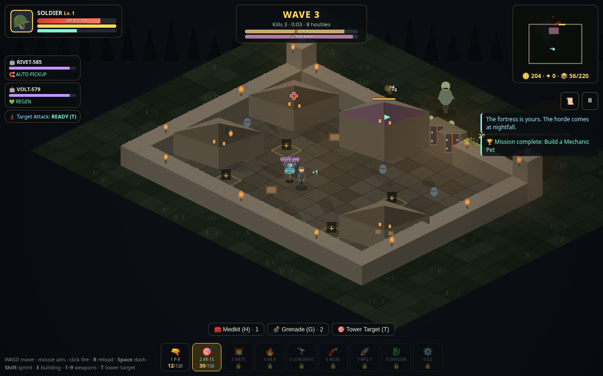
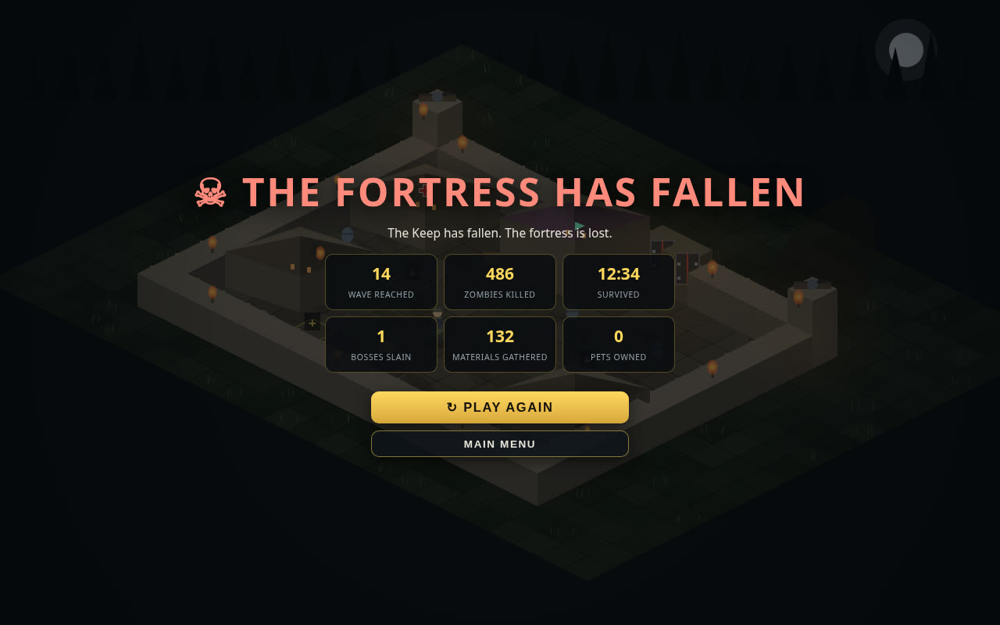

# ZOMBIE FORTRESS: LAST STAND 🧟

An isometric survival shooter and fortress-defense game for the
[make.fun best-game-01](https://make.fun/bounty/best-game-01) bounty. Hold a
torch-lit medieval fortress against endless waves of the dead: shoot, loot
every corpse **by hand**, upgrade nine weapons and six fortress facilities,
man the guard towers, and build an army of **Mechanic Pets**.

## The stand

- **Endless waves** with the full bestiary: Walkers, Runners, Crawlers that
  slip through wall gaps, structure-smashing Tanks, Exploders, Screamers
  that call the horde, Armored zombies with a weak back, and Mutants — plus
  a rotating **boss every 10 waves** (The Brute, The Butcher, The
  Abomination, The Commander, The Colossus), each with telegraphed special
  attacks and phases.
- **A living fortress**: a gate and walls with their own HP that zombies
  chew through, two guard towers, a Workshop, a Medical Station, a
  Warehouse with real storage capacity, and the Keep at its heart. If you
  fall — or the Keep falls — the run ends.
- **Guard towers with two modes**: automatic random-target fire, and a
  player-called **Target Attack** (3× focused damage) that rests exactly
  one wave between uses, per the design spec.
- **Nine weapons** — pistol, assault rifle, shotgun, SMG, .50 sniper, LMG,
  rocket launcher, flamethrower, minigun — each with its own ammo pool and
  five upgrade tracks in the Armory.
- **Mechanic Pets**: build as many as you want, deploy **up to 2 at once**.
  A pet deals **20% of your damage**, procs a buff or debuff on **10%** of
  hits, and carries at most **2 skills**, installed and combined with **Pet
  Skill Stones**: *Auto Pickup* (fetches drops for you), *HP Regeneration*
  (stacks across pets), and *One Hit Kill* — **10%** on normal zombies,
  **1%** on elites, **0.01%** on a boss whose HP is under 75%.
- **Manual pickup economy**: zombies drop gold, scrap, iron, wood,
  electronics, mech parts, medicine, ammo and rare Pet Skill Stones; items
  lie on the ground until you (or an Auto-Pickup pet) walk over them, and a
  full Warehouse leaves them lying there.
- Level-up choices (pick 1 of 3), buildable turrets / MG nests / flame
  traps / spike strips, gate mines, grenades and medkits, ten lifetime
  missions, and **permanent progression** — facilities, weapon upgrades and
  your whole pet roster persist between runs in local storage.

## Controls

WASD move · mouse aim · click/hold fire · **R** reload · **Space** dash ·
**Shift** sprint · **E** use a building · **1–9** weapons · **G** grenade ·
**H** medkit · **T** tower Target Attack · **Esc** pause. On touch screens:
twin virtual sticks plus dash / reload / grenade / interact / heal / target
buttons.

## Tech

One static page: HTML5 Canvas 2.5D isometric rendering, synthesized
WebAudio (a brooding sequencer soundtrack and per-weapon gunfire), no
assets, no network. The simulation is modular ES modules under `game/src/`
(config / fort / zombies / pets / game / panels / render).

## Screenshots

| Menu | Wave 3 | Boss wave | The fall |
| --- | --- | --- | --- |
|  |  |  |  |
